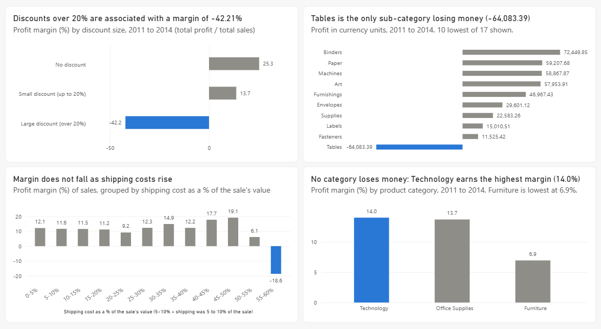

# Profit Leakage Agent

An AI agent that finds where a retail business loses money. It is built directly on the Claude API, with a one-page brief and a Power BI dashboard.

**Finding:** sales discounted by more than 20% earned a margin of -42.21%, against 21.30% for sales discounted by 20% or less (including none), from 2011 to 2014.

- One-page brief: [brief/profit-leakage-brief.pdf](brief/profit-leakage-brief.pdf)
- Power BI dashboard (picture): see below



## The question

Which products, regions or customer segments are losing money, and what should the business change?

The data is Global Superstore from Kaggle (by fatihilhan): 51,290 order lines, from 2011 to 2014. An order line is one product on one order. The currency is not stated, so amounts are in "currency units". Margin means total profit divided by total sales, worked out after adding up.

## How the agent works

The agent is Claude plus five fixed code tools, running in a loop with a cap of 15 steps. Each round, Claude either asks for a tool or writes its answer. The tool is plain code, so all the arithmetic happens there. Claude never calculates anything itself.

| Tool | Its one job |
|---|---|
| `load_data` | Reads the file and describes it. Changes nothing. |
| `clean_data` | Drops empty columns, converts dates, counts duplicates before removing any. |
| `calculate_by_group` | Groups rows, adds up sales and profit, then works out margin from the totals. |
| `export_table` | Saves a table as CSV, then reads the file back and compares it. |
| `make_bar_chart` | Draws one sorted bar chart from a fixed template. |

The agent's instructions include these rules: every number must appear in a tool result; write "associated with", never "caused by"; say when you chose a cutoff yourself; test more than one explanation. I used Haiku for testing and Sonnet for the final run.

## How I checked the numbers

- **By-hand benchmark.** I built the same tables by hand in Power BI. `test_benchmark.py` compares the agent's tools with them and ends with `ALL TABLES MATCH`.
- **Built-in checks.** Every calculation must add back to the whole table (a reconciliation check). Every exported file is read back and compared with the table.
- **Loop test.** `test_agent_loop.py` runs the loop with a fake Claude, including bad inputs, and ends with `ALL PASSED`.
- **Final run.** One Sonnet run cost about 8 cents (30,253 tokens in, 2,167 out). Each run saves a record in `output`.

## What I found

- 11,328 order lines carried a discount over 20%. 89.9% of them lost money, against 5.9% of the others. The pattern holds in every category, customer segment and year, and in every region that has any such lines.
- Tables (a furniture sub-category) is the only sub-category with a net loss: -64,083.39 over four years. Its lines discounted over 20% have a net loss of 132,541.15.
- No region or customer segment loses money overall. Shipping cost as a share of the sale did not explain the losses, and no category loses money.
- Recommendation: test a 20% discount cap on Tables first, and compare its margin with the other sub-categories over the same period.

The brief has the numbers and the charts.

## What went wrong, and what it taught me

1. **Right numbers, wrong conclusions.** In one run the agent said South had the most loss-making order lines (1,688), when Central has 2,782. In another it said 30 of 147 countries lose money, when the answer is 29. A number check catches invented numbers, not wrong comparisons. I fixed the miscount in code (the calculate tool now states the group counts) and I read every answer against the tables.
2. **The agent removed 9 rows as duplicates in the final run.** They match on the nine columns it chose, but each pair has a different row ID and shipping cost, so I judged them to be real line items. The brief uses all 51,290 rows. The effect is small: the over-20% margin is -42.22% in the agent's run and -42.21% in the brief.
3. **The agent said its 0.2 cutoff was a round number, "not taken from the data".** That is only half true. I picked 20% partly after looking at profit by discount level, so the brief says so.
4. **A few numbers in the brief do not come from the five tools.** Comparing the same product at two discount levels needs a different kind of grouping. Those numbers (the same-products comparison and the "what if those lines disappeared" figures) come from `extra_checks.py`, plain pandas. The brief does not say this, so I say it here.
5. **Power BI ignored a new column on refresh.** Its CSV import step was fixed at 7 columns. Changing it to 8 fixed it.

## Limits

- **Volume is untested.** The data cannot show whether a cap would cost sales. If every over-20% Tables line disappeared, Tables profit would move from -64,083.39 to +68,457.76, but this ignores knock-on effects.
- **The 20% cutoff was partly fitted to the data.** Margin falls steadily as discounts grow and is near zero between 20% and 25%, so 20% is a cautious cap, not a precise threshold.
- **This shows an association, not cause.** The same products earn 21.46% at 20% or less and -42.31% above 20%, so it is not only bad products. I cannot rule out other reasons.
- **The shipping check is weaker.** Its last two groups hold only 14 and 3 sales. Profit also appears not to include shipping cost.
- **The data is public, from 2011 to 2014, and may be synthetic.**

## Run it yourself

You need Python, the libraries `anthropic`, `pandas`, `numpy` and `matplotlib`, and your own Anthropic API key stored in the environment variable `ANTHROPIC_API_KEY`. Download the dataset from Kaggle (link below). It is not included here.

Free checks (no key, no cost):

```
python test_benchmark.py superstore.csv
python test_agent_loop.py superstore.csv
python make_dashboard_tables.py superstore.csv
python make_brief_charts.py superstore.csv
python extra_checks.py superstore.csv
```

Run the agent (paid, about 8 cents on Sonnet):

```
python agent.py superstore.csv claude-sonnet-5-5
```

## Files

- `agent.py`: the loop and the instructions
- `tools.py`: the five tools
- `test_benchmark.py`, `test_agent_loop.py`: the tests
- `make_dashboard_tables.py`, `make_brief_charts.py`, `extra_checks.py`: free scripts for the dashboard, the brief's charts and the brief's extra checks
- `decision-log-agent.md`: every technical choice and why
- `brief/`: the one-page brief

## Data and licence

Dataset: [Global Superstore by fatihilhan on Kaggle](https://www.kaggle.com/datasets/fatihilhan/global-superstore-dataset). The dataset page lists an MIT licence. Its copyright lines name Mark Otto and Andrew Fong, and I could not confirm who created the original data. For that reason I link to the dataset and do not include the data file in this repository.
